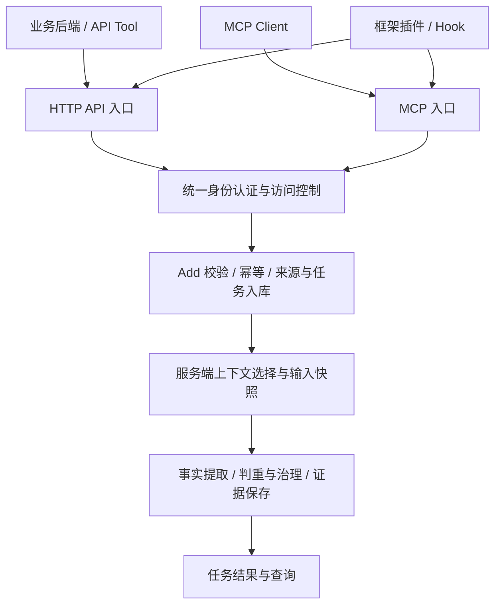

# Add 接入层优化方案

日期：2026-10-12。

状态：2026-10-12 已按本轮确认实施 Add 核心链路优化，实际接口与迁移要求见 [ADD 接口运行说明](./ADD接口运行说明.md)。MCP／插件、公司鉴权、终态任务管理恢复和已完成来源的受控重处理入口暂缓。

本轮冻结：无已接入客户端，保留 `results.event=ADD` 并新增逐消息／片段的 `processing_results`；会话、来源按租户／Agent／来源系统／用户／会话隔离，请求幂等按租户／Agent／用户／客户端键隔离；保留普通顺序等待，前序失败终态不传播；迁移保留来源及任务关系，拒绝模糊 Agent 归属，采用停写事务迁移。后文尚未交付的完整接入与恢复设计继续作为后续要求，不视为已有公共能力。

## 1. 核心决策

> 调用方按稳定会话提交新增原始消息；记忆服务保存来源，并结合已接收的同会话必要前文提取记忆。对于首次接入、按需调用或缺失历史，调用方可随请求补充上下文。HTTP API、MCP 和框架插件共用同一套处理规则。

采用这一契约的原因是：项目需要降低多个业务 Agent 的接入成本，统一多轮提取质量，并保存可追溯的来源证据。服务已经保存原始来源，可以复用这些记录组织上下文；不要求每个业务重复实现历史窗口、指代关联和预算裁剪。

同时明确以下边界：

- 各 Agent 的业务会话独立，同租户、同用户的长期记忆默认共享。
- 服务只能使用已经接收的消息，不能自动取得业务 Agent 未提交的对话。
- 服务端上下文处理属于 Add 业务链路的内部模块；HTTP 路由、MCP 处理函数和框架插件不各自维护一套提取策略。
- 来源保存、上下文可用、提取完成、形成记忆是不同状态，不能用单个“已处理”标记替代全部含义。
- 保留来源与任务的事务提交、异步执行、请求幂等、证据治理和有限等待能力。

本文是[原接入与抽取触发方案](./MemoryCMIC-对话接入与抽取触发方案-最终版.md)的后续优化依据。涉及上下文、证据、失败恢复和接入职责的后续设计以本文为准；当前已发布行为仍以代码和 [ADD 接口运行说明](./ADD接口运行说明.md)为准，不能提前按本文调用尚未实现的字段或入口。

## 2. 接入方式与触发方式

| 接入方式 | 交付内容 | 接入方职责 |
| --- | --- | --- |
| HTTP API 接入 | 标准接口，以及按需提供的客户端封装 | 获取原始消息、身份和会话，提交增量或一次性批次，可靠重试 |
| MCP 接入 | MCP Server 暴露记忆工具 | MCP Client 所在应用提供业务身份、会话及原始消息；按需调用时补充尚未提交的必要前文 |
| Agent 框架插件接入 | 针对已验证框架版本的插件 | 通过框架事件采集消息，完成格式映射、身份注入和可靠投递，调用 API 或 MCP |

MCP 是通信协议，插件是集成形式。插件可以调用 API 或 MCP，三种接入方式不代表三套互斥的底层技术。SDK 和 CLI 是调用、安装或配置辅助，不新增业务契约。

触发方式单独定义：

| 触发方式 | 推荐行为 |
| --- | --- |
| 回合结束后自动提交 | 插件或业务 Hook 收集完整回合的新增用户消息、最终回复和必要工具记录，异步投递 |
| 用户要求记住或更正 | Agent 调用 API Tool 或 MCP Tool；运行时提供原始依据，必要时等待任务结果 |
| 一次性批量导入 | 调用方按原始顺序分批提交需要提取的消息，保留原始时间；缺少可靠时间时按第 5 节降级 |

持续采集是降低多轮历史缺失风险的推荐方式。仅安装 MCP Server 不等于开启自动对话采集；按需调用也不保证服务此前已经收到历史。

## 3. 模块职责

| 模块 | 负责 | 边界 |
| --- | --- | --- |
| 接入适配 | 原始消息采集、格式映射、稳定标识、凭证携带、重试 | 不让模型生成身份或时间，不替服务执行最终授权；不伪造缺失原文 |
| 身份认证与访问控制 | 凭证验证、可信身份、租户及用户范围、操作权限 | API 与 MCP 复用业务规则；协议相关的凭证处理由各入口适配 |
| Add 接入 | 校验标准输入、请求与消息去重、来源持久化、任务创建、接收回执 | 不在数据库事务中等待模型；接收成功不等于提取完成 |
| 上下文处理 | 读取同会话有效来源、关联查找、顺序与去重、预算选择、输入快照 | 不主动抓取外部业务历史，不把其他 Agent 会话或共享记忆冒充本会话原话 |
| 提取与治理 | 事实抽取、证据校验、同用户记忆判重与纠正、变更提交 | 上下文用于理解；新事实仍须有本次目标用户的新陈述或确认 |
| 任务与恢复 | 租约、重试、部分提交恢复、受控重处理、结果查询 | 不把一个任务的最终失败传播成整个会话的连续失败 |

以上首先是代码职责划分，可部署在同一服务中。复用现有 `source_record`、任务和证据模型，不另建重复的对话正文库，不先建设独立上下文服务。

## 4. 身份认证与访问控制

统一认证授权模块属于服务公共能力，Add、任务查询及其他用户接口共同使用。接入组件负责取得和携带凭证，服务端负责最终判断。

### 4.1 当前阶段

- 保留静态服务凭证及其租户、调用 Agent 和允许来源限制。
- `user_id` 仍由受信任业务后端提供；当前凭证只能确认接入系统，不能证明该系统指定的用户就是实际登录用户。
- 不因接入 MCP 或插件而移除现有认证，不将管理能力开放给普通记忆工具。

### 4.2 用户身份接入后的目标

- 可信用户身份来自公司认证验证结果；正文保留 `user_id` 时须核验一致性。
- 租户来自明确的服务配置或可信关系，不假定公司凭证含租户或 Agent 身份。
- 在来源写入、幂等结果重放及任务查询前完成授权。
- 用户 Add 回执按已认证用户及允许公开的任务类别检查；同用户跨 Agent 查询自己的回执按既有身份方案推进，不据此开放原始会话历史或管理任务。
- 自报 Agent 来源仅用于来源标记和命名空间，不作为授予用户数据或管理权限的依据。静态凭证提供的可信调用 Agent 与未来自报来源应区分。
- 业务用户标识由接入侧映射到统一用户身份，服务不通过姓名等内容猜测同一人。

公司验证接口、凭证协议和租户确定方式尚未冻结，继续遵循[用户身份授权与跨 Agent 共享实施方案](./用户身份授权与跨Agent共享实施方案.md)。核心链路优化可先进行，用户鉴权部分在外部条件明确后实施。

MCP 的具体授权流程需随选用的传输方式和客户端能力确定。共用业务授权规则不等于各入口无条件接受同一 token；MCP 转调独立下游服务时需验证凭证适用对象及委托方式，不默认透传。

## 5. 字段责任与接入要求

### 5.1 字段处理原则

先区分“模型可见工具参数”和“标准接入数据”。标准入库需要的字段，不必都暴露给 LLM。API Tool、MCP 客户端集成和插件应从运行时获取技术信息；缺少必需能力时报告接入缺口，不能靠提示词让模型补造。

本方案不把全部必填字段改成可选。首期保留严格标准消息契约，通过接入实现补齐可生成的信息；只有定义好服务端默认语义、重试行为和兼容方式后，才调整 HTTP Schema。

| 字段 | 当前契约 | 优化要求及责任 |
| --- | --- | --- |
| 凭证 | Bearer 服务凭证 | 接入程序携带，统一模块验证；不进入模型工具参数、来源正文或日志 |
| `source_system` | 必填 | 来自接入配置，表达来源系统；不直接代表业务适用范围或授权 |
| `user_id` | 必填 | 当前由受信任后端提供，未来绑定可信用户身份；LLM 不选择 |
| 来源 Agent | 当前由凭证确定 | 保留独立来源语义，支持会话命名空间；未来用户凭证模式的传递方式需明确 |
| `session_id` | 必填 | 保留稳定会话要求；有原生 ID 则映射，无原生 ID 则由接入程序创建并持久化；不每次调用随机生成 |
| `messages` | 1–100 条目标消息 | 提交需要评估的新信息，可含完整多轮原文；重复来源仍可参与理解，不重复创建来源 |
| `history_messages` | 可选，最多 100 条 | 保留，用于补充未接入的前文；不独立产生本次新事实，后续可用性见第 7 节 |
| `message_id` | 每条必填 | 优先原生 ID；缺少时由接入组件首次采集生成并持久化，重试复用；不能以正文哈希作为消息身份 |
| `role`、`content` | 角色和非空文本必填 | 从原始消息映射；允许有有效工具调用或附件引用的空文本消息，完全无内容仍拒绝 |
| `occurred_at` | 每条必填、带时区 | 原始时间优先；缺失时由接入组件记录首次观测时间并标记来源，不能冒充原始事件时间 |
| `timestamp_origin` | 默认 `source` | 观测时间必须显式标为 `adapter_observed`；传递给上下文、抽取和治理模块 |
| `author_id` | 可选 | 从原消息或可信默认值解析；区分消息作者与提交 Agent |
| `turn_id`、`reply_to_message_id` | 可选 | 不要求补造；有值则参与关联选择，未知关联记录诊断 |
| 工具名称、调用 ID、状态 | 工具消息条件必填 | 接入组件映射实际工具关系；未知状态默认 `unknown`，不猜测成功。缺少关联 ID 时须定义稳定映射，不能每次投递重建关系 |
| `Idempotency-Key` | 必填 | 接入程序为投递批次生成并持久化；相同请求重试复用，与消息 ID 分开 |
| 等待参数 | 可选 | 保留异步默认及有限等待，等待超时不表示任务失败 |

首期不新增业务域、项目 ID、置信度、TTL 或内部版本等调用方必填字段。

### 5.2 消息与时间适配

- 采集最终原始消息，过滤内部思考、框架控制提示、注入的检索记忆及未完成流式片段。不得把模型总结重新标成用户原话。
- 支持纯工具调用消息后，切片及处理标记也须支持其结构化内容，不能只放宽校验后静默丢弃。
- 附件引用保留来源信息，不意味着服务已经下载、读取或理解附件正文；没有可读依据时不生成附件内容事实。
- 原始时间与观测时间在下游保持可区分。未知原始时间的历史导入，不将“本周”等相对日期按导入时间强行解释，也不依靠该时间覆盖更新事实。
- 事件顺序与事件时间分别处理；不能因为两个观测时间存在偏差，就简单判定历史来自未来。服务必须有可靠的批次、数组或显式关联依据，不能静默猜测全局顺序。
- 同一来源的重放须保持正文、角色、时间及关系稳定。后续补充关联或时间精度如何处理，应在兼容设计中明确，不能覆盖原证据或无提示改变语义指纹。

## 6. 会话隔离、幂等与顺序

### 6.1 隔离范围

业务会话的逻辑范围须能够区分：租户、用户、来源 Agent／应用、来源系统和外部会话 ID。实现可使用内部会话 ID 加映射，不要求把所有维度拼接到公共字符串中。

同用户不同 Agent 的会话不能互相补历史；同用户的已形成长期记忆仍可用于跨 Agent 检索和治理。用户级共享不等于原始会话全文共享。

统一调整来源唯一性、会话绑定、批次序号、历史查询、任务调度和恢复范围，避免只改其中一个查询。已有来源和任务的标识需通过迁移或兼容映射保留，不直接重写全部历史记录。

### 6.2 三种去重分别处理

| 层级 | 判定内容 | 要求 |
| --- | --- | --- |
| 请求幂等 | 是否同一投递请求 | 同键同内容返回原任务；同键不同内容报冲突；用户、来源及租户范围清晰 |
| 来源去重 | 是否同一条原始消息 | 同消息身份只保存一份来源；不同消息即使正文相同仍是独立来源 |
| 记忆判重 | 是否表达相同事实 | 可补证据而不重复创建记忆；不能仅靠来源去重替代 |

同一 Agent 的不同用户使用相同客户端幂等键应互不冲突。锁范围、数据库约束和查询条件同步调整，并在鉴权改造阶段与用户身份方案对齐。

API Tool、MCP 和 Hook 同时启用时，接入方需复用消息身份；来自不同触发方式的重复投递不得累计成多份独立证据。已接收标记与抽取完成标记分开，接收成功后无需业务模型决定后台是否重试。

批内保持数组顺序；接入方按会话顺序可靠投递，服务为已接收批次建立稳定边界。仅有接收顺序不能还原网络乱序前的真实顺序，乱序导入需有原始关系或时间依据，否则记录缺口，不声称已恢复真实对话。

## 7. 服务端上下文处理

### 7.1 来源和边界

上下文来自同一会话内的有效来源，包括本次显式历史和服务已接收的前序消息。来源是否可用于理解与其所属任务是否成功提取记忆分开判断：模型故障未形成记忆，不代表已保存的原话不可用；已撤回、失效或版本不匹配的来源不得继续使用。

每次任务固定其接入边界。执行时不能查询无边界的“最新消息”，把后来的对话混进旧任务。首次执行选定后保存来源 ID、版本、顺序及切片快照；普通重试复用快照，提交前重新检查依据有效性。

### 7.2 历史选择

1. 从已接收且处于本任务边界内的来源查找直接回复、用户确认所依赖的前文和必要工具关联。
2. 合并本次显式历史与必要关联消息，按来源身份去重，排除与目标重复的上下文项。
3. 补充有限的近期前序消息。当前 30 条可作为普通候选窗口初值，不作为所有关联消息的硬截断边界。
4. 根据总预算形成输入，优先保留必要关联与完整语义单元，再保留普通近期历史。

必要关联超过普通窗口时应按 ID 在授权会话范围内查找，仍受固定边界和总预算限制。不能要求所有历史无限保留在模型输入中；必要依据仍放不下时，缩小目标切片或报告上下文不足，不静默丢掉依据后声称提取完整。

长消息保留原文定位；连续片段需保留理解所需的衔接。`turn_id`、工具调用关系和时间来源应按实际用途进入输入构造，不仅保存到数据库。

### 7.3 补充历史的持续性

本次显式提交的 history-only 消息保存为来源。在前后关系可信时，后续同会话任务可继续选用，不要求业务每轮重传。补交不会把旧消息变成最近的新发言，也不因此独立触发事实提取。

实施时为补充历史保留锚定批次、批内顺序和已知关联，合并时不简单追加到自动历史末尾。无法确定相对位置的历史保留不确定性：可供当前显式请求理解，或由后续明确引用使用；不得自动插入一个猜测的位置。

后补历史不改变已执行任务的冻结输入。如需重新评估上下文不足的旧目标，通过第 9 节的受控重处理形成新任务。

### 7.4 已处理消息与缺失上下文

- 重复来源即使不再作为新目标抽取，仍可作为本批上下文参与理解。
- 区分“没有持久记忆价值”和“缺少必要上下文”，在可定位到消息或片段的粒度记录结果及原因，不能仅返回一个空事实数组后永久标记完成。
- “没有持久价值”的正常消息仍可帮助理解后续发言。
- 对未确定缺失原因的空结果，不擅自标成某个具体原因；抽取输出和服务校验需提供支撑。
- 不把共享长期记忆替换成本会话的原始证据。已有记忆用于判重与治理，与来源上下文保持语义区分。

## 8. 多轮事实的证据完整性

正式事实至少由一条本次目标用户消息的新陈述或确认支持，同时允许引用本次实际使用的必要历史。

例如：历史 assistant 询问“以后周报采用三段式，可以吗？”，本次 user 回答“可以，以后都这样”。形成偏好时两条消息应在同一支持组内，不能只保存“可以”。

实施要求：

- 扩展证据 ID 校验和来源映射，允许引用输入快照中的有效历史，同时保留目标用户锚点约束。
- 辅助历史不能单独产生本次新事实；assistant、system、tool 的内容不能直接冒充用户声明。
- 持久化真正支撑事实的必要消息及版本，不把全部窗口一律当作证据。
- 支持组中任一必要来源失效时，该组不能继续独立支撑事实；存在其他完整有效支持组时按既有依赖规则判断。
- 重放、重试及受控重处理不会重复添加同一组依据；原始片段和定位可以还原，历史来源的撤回能触发相关记忆检查。
- 用户纠正作为新陈述保存，治理仍需比较来源时间与事实时间，避免旧任务恢复后覆盖更新事实。

## 9. 任务失败、恢复与重处理

### 9.1 失败不连续传播

保留正常同会话有序处理。前序任务在可重试阶段可以按顺序等待；前序达到失败终态后，不再无条件将后续任务标为 `PRIOR_TASK_FAILED`。

后续任务基于有效来源正常组装上下文：前序原话有效则可以使用；必要来源不可用时记录缺口，只停止无法可靠判断的候选。使用历史理解不代表补做该历史中尚未完成的全部事实提取。

后续治理仍需用户范围的并发控制、时间比较和提交前校验。原任务稍后恢复时不得覆盖更新事实，也不因上下文解耦而放宽这些约束。

### 9.2 恢复机制

区分三类动作：

| 动作 | 输入及结果规则 |
| --- | --- |
| 请求重放 | 同一幂等键返回原任务，不强制重开终态 |
| 执行重试／失败恢复 | 输入快照与来源版本未变时，复用原计划，从未提交进度继续 |
| 补充上下文后的重处理 | 新建关联原任务的处理任务，选用新的有效上下文；保留原结果和审计，不覆盖原执行历史 |

本轮按用户确认暂缓终态任务管理恢复入口，优先交付失败终态不阻塞后续任务；普通自动重试保留冻结计划和已提交进度。后续服务侧受控恢复可采用管理命令，再冻结具体入口。仅允许有权限的操作方在输入可验证、上下文确有补充等条件下触发，不要求普通业务 Agent 编辑任务状态，也不引入无限自动循环。

任务恢复和重新抽取均需保证：已提交片段不重复写入；已失效来源不能继续使用；旧结果不能覆盖更新事实；恢复动作、触发原因、所用输入和结果可审计。长输入或模型调用预算耗尽仍可报告失败／部分完成，但不能永久阻断后续会话。

## 10. 任务回执和业务结果

保留 `task_id`、任务查询、异步默认和有限等待。200/202 表达请求／任务当前状态，接入组件不能仅凭 HTTP 成功就回复“已经记住”。

| 业务情况 | 需要表达的含义 |
| --- | --- |
| 已接收、处理中 | 来源已接收，抽取尚未确认 |
| 新增有效记忆 | 本次形成了可用记忆 |
| 已有事实、补证据 | 信息已存在或本次增加依据，不是提取失败 |
| 纠正已提交 | 新事实与旧事实的替代处理已经提交 |
| 形成争议 | 尚不能作为已确认的新事实使用 |
| 没有可保存事实 | 正常无产出，不表示系统故障 |
| 上下文不足 | 当前依据不足，不能声称已记住 |
| 部分完成／失败 | 明确已完成范围和主要原因，不泄露无权访问的记录 |

一批可包含多种情况，结果不能只用一个批次原因覆盖所有消息。优先提供支撑业务判断的最小结果信息，不公开完整内部诊断或模型推理。

`MemoryResult.event` 保留 `ADD`；本轮通过新增 `processing_results` 表达新增、补证据、纠正、争议、无持久价值、上下文不足等结果。字段与枚举以运行说明及 Schema 为准；MCP 和插件后续基于统一结果解释，不能自行从 `results=[]` 猜测。

## 11. 当前差距与改动位置

| 已确认的现状 | 改造目标 | 主要位置 |
| --- | --- | --- |
| 标准请求要求调用方传完整技术字段 | 明确运行时注入、字段默认与缺失处理，避免 LLM 补造 | `api_schemas.py`、接入组件 |
| 会话键未包含调用 Agent，来源命名空间可能重叠 | 各 Agent 会话独立；查询、锁、约束一致 | `ingest.py`、`models.py`、`task_queue.py`、`worker.py` |
| 历史查询依赖前序任务状态，且只自动取前序 target | 有效来源与抽取状态分离，补充历史在关系可信时持续可用 | `worker.py`、来源／任务关系 |
| 先限制最近 30 条，再优先 reply；目标可能占满预算 | 必要关联先查找，切片为必要上下文留空间 | `extraction_input.py`、上下文查询 |
| 已评估无事实也设置处理版本，后补历史不会重开 | 原因可区分，提供受控重处理；已处理来源仍可作上下文 | `worker.py`、提取输出、任务记录 |
| 证据只能引用本次目标 | 允许必要历史参与，同时要求目标用户锚点 | `providers.py`、`worker.py`、证据校验 |
| 前序失败使后续任务直接失败 | 失败不传播，提供按进度恢复 | `worker.py`、`task_queue.py` |
| 空文本工具调用被拒绝，部分关联与时间来源未传给模型 | 支持有效结构化消息，贯通对应字段 | `api_schemas.py`、`worker.py`、`extraction_input.py` |
| 来源与会话字符串拼接成 `target_id` 可超数据库长度 | 使用长度受控的内部标识，保持公开字段限制与存储一致 | `ingest.py`、`models.py` |
| 回执只有 ADD，多个业务情况同为空结果 | 提供明确且兼容的业务结果 | `api_schemas.py`、`task_results.py`、接口文档 |
| 静态凭证不验证实际用户 | 外部条件明确后接入统一用户身份校验 | `auth.py`、`api.py`、MCP 入口 |

## 12. 实施顺序与兼容要求

| 阶段 | 交付物 | 阶段验收 |
| --- | --- | --- |
| P1：冻结接入细节 | 标准消息与工具参数分工、会话命名空间、结果协议、恢复入口及迁移设计 | 覆盖持续采集和按需调用样例；旧客户端及旧任务的处理规则明确 |
| P2：优化核心链路 | 来源／处理状态区分、上下文选择、完整证据、失败恢复、字段缺陷修复 | 多轮、补历史、重试、跨 Agent 隔离和并发治理用例通过 |
| P3：交付接入组件 | MCP Server 与选定框架首个插件／API Tool 参考接入 | 同一测试消息通过不同入口产生等价来源和结果，进程重启后可继续投递 |
| P4：接入公司身份 | 真实用户验证、租户确定、对应幂等及回执授权调整 | 用户与租户隔离验证通过，普通身份不能操作管理能力 |

P4 受公司接口条件影响，可在条件明确后与 P2／P3 并行，但不能将静态服务凭证联调当作用户身份保护验收。远程 MCP 的正式开放还需完成该部署方式对应的认证授权验证。

兼容要求：

- 原有合法请求在兼容期仍可提交，不能要求所有业务和插件同时升级。
- 对消息唯一性、会话范围和幂等约束的变更先核对存量冲突；保留原任务 ID、来源证据和审计关系。
- 已有完成任务不因上线自动全量重提取；新旧任务的输入快照和恢复能力按版本区分。
- 数据迁移需明确并发写入处理、验证和回退方法。不得直接删除原始来源来消除键冲突。
- 公共结果格式如存在破坏性调整，需显式版本化或明确过渡方式，不静默更换枚举语义。
- 上线对应能力时同步更新运行说明、旧方案指引和接入样例，避免“设计目标”与“实际接口”混用。

## 13. 验收清单

以下为待实施的验收要求，不表示本轮已执行或通过。

| 编号 | 场景 | 通过标准 |
| --- | --- | --- |
| A01 | API、MCP、插件提交同一标准消息 | 认证边界、来源身份、抽取和结果语义一致 |
| A02 | 原始框架没有消息 ID 或时间 | 接入组件按约定补齐并保存；重启重试后数值不变，时间来源如实标记 |
| A03 | 响应丢失、超时、进程重启后重投 | 同键返回原任务，不重复来源和记忆，不改变批次内容 |
| A04 | Hook 与工具重复提交同一消息 | 复用来源，不累计为多份独立证据 |
| A05 | 两个 Agent 使用相同用户和外部会话 ID | 不混用原始历史、处理顺序或恢复状态；同用户长期记忆仍可共享 |
| A06 | 同 Agent 不同用户使用相同幂等键 | 不冲突、不重放其他用户回执 |
| A07 | 前一轮提问，后一轮回答“对，以后都这样” | 自动使用已接收前文，事实有完整证据，必要历史失效时依赖检查生效 |
| A08 | 仅通过 MCP 提交“记住这个”，此前未上传对话 | 不虚构指代；报告依据不足，补充原文后可处理 |
| A09 | history-only 消息一次补交 | 前后关系可信时后续可继续使用；不会被当成新发言或独立新事实 |
| A10 | reply 指向近期普通窗口以外的消息 | 在同会话和固定边界内查找；超预算或不存在时明确缺失，不串读 |
| A11 | 长目标、长历史、跨片引用 | 必要上下文保留或明确无法处理；目标不静默丢失，证据定位可还原 |
| A12 | 消息已处理，本次作为重复目标或历史提交 | 去重后仍可辅助理解新目标，不重复写入 |
| A13 | 首次上下文不足，随后补齐并受控重处理 | 使用新输入生成可追溯任务，不覆盖原执行记录，不重复证据 |
| A14 | 前序抽取终态失败，但原始来源有效 | 后续可继续并使用有效前文，不连续生成前序失败错误 |
| A15 | 部分提交后故障恢复，或旧任务晚于新事实恢复 | 不重复已提交变更，不覆盖更新事实，失效来源不能继续支撑记忆 |
| A16 | 执行过程中出现后来消息或来源版本变化 | 不混入未来消息；提交前校验生效，不提交失效依据结果 |
| A17 | 空文本但有工具调用或附件引用 | 合法结构化消息可接收和保存；不把附件引用当作已读取正文 |
| A18 | 无原始时间的旧对话导入 | 观测时间可识别，相对日期不按导入时间强行解释，不错误覆盖新事实 |
| A19 | 请求使用合法最大长度标识 | 校验通过的标识可安全入库，内部任务 ID 不溢出 |
| A20 | 新增、重复、纠正、争议、无事实、上下文不足混合批次 | 结果可分别解释，异步未完成不宣称已记住 |
| A21 | 无效凭证、跨用户／跨租户请求、越权任务查询 | 在写入或重放前拒绝；用户鉴权部分在 P4 使用真实验证链路验收 |

验证应覆盖单元测试、数据库集成测试及少量真实模型多轮样例。协议一致性、恢复和权限由确定性测试验证；指代消解与事实质量另用固定原始对话评估，不能以模拟模型测试替代真实提取质量结论。

## 14. 待明确的外部条件与首期范围

实施接入组件前需明确：首个 Agent 框架及版本、可用消息 Hook、原始 ID／时间／会话能力、重启后的投递存储位置、MCP 客户端及传输方式。不同框架能力不能预先假定一致。

公司鉴权继续等待真实验证协议和用户／租户映射条件；无需提供真实 token 到文档或仓库。

首期不增加跨 Agent 同会话接力、多人群聊主体建模、主动抓取外部业务历史、任意框架自动适配或新的分 Agent 用户授权体系。附件解析、任意文本直接写成正式记忆等独立能力不随本次接入优化扩展。

## 15. 关联资料

- [ADD 接口运行说明](./ADD接口运行说明.md)：现有公开行为及运行方式。
- [原对话接入与抽取触发方案](./MemoryCMIC-对话接入与抽取触发方案-最终版.md)：原设计依据，后续优化差异见本文。
- [用户身份授权与跨 Agent 共享实施方案](./用户身份授权与跨Agent共享实施方案.md)：身份、共享和暂缓事项。
- [统一记忆服务选型验证与技术路线决策报告](./统一记忆服务选型验证与技术路线决策报告.md)：自有核心、来源证据和开源借鉴边界。
