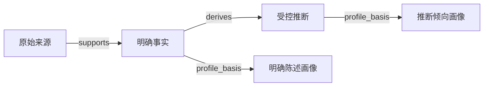

# 记忆治理与推断画像统一优化方案

日期：2026-10-10。状态：设计建议，尚未实施。

本文已按讨论收敛为 maintenance、consolidation、profile 三条运行链路，并补充画像候选资格及条件触发规则。保留现有 Worker 和任务队列，不新增固定六阶段强编排、专用 `GovernanceRun` 表或跨 Worker 完成屏障。源码依据参见 [EverOS 与 Honcho 后台整理并发机制源码审查](./EverOS与Honcho后台整理并发机制源码审查.md)。下文描述目标行为，现状另行标注；建议时间参数尚未实施。

## 1. 目标、范围与验收边界

本方案服务于项目“跨 Agent 的统一长期记忆基础设施”定位：让事实保持有效，让冲突有处理出口，让推断可追溯，让画像持续反映当前可靠信息。

本轮覆盖用户事实、用户推断、用户画像及其证据、向量、治理任务。不扩展到 Agent 经验学习、组织公共规则仲裁，不增加自动人格推测，也不实施历史记录物理清理。

目标：

- 整理任务报告事实整理、冲突复核和推断更新结果；关联的画像、向量等任务分别报告状态。
- 到期、撤回、纠正和证据失效及时影响在线使用；不依赖周期性模型整理才能生效。
- 冲突得到复核；无法裁决的冲突保持停用并明确列为待澄清。
- 画像允许使用合格推断，同时保留明确陈述与推断倾向的区别。
- 重复执行不重复造记忆；执行中依据发生变化时，不提交过时结果。
- “执行成功”“没有未决问题”“派生数据更新完成”分别表达。

## 2. 当前实现与已核对的数据

当前路径：

| 模块 | 当前职责 | 主要缺口 |
| --- | --- | --- |
| Add Worker | 抽取事实、判重、显式替代、标记争议，触发画像更新 | 后台未形成同等完整的冲突复核路径 |
| maintenance Worker | TTL、证据依赖复核、向量维护 | 不是一次完整整理；不能重算推断 |
| consolidation Worker | 对 active fact 合并、显式失效、推断、记录疑似过时 | 跳过 disputed；同时承担事实治理与新增推断 |
| profile Worker | 从有效、当前、长期、非项目限定事实生成独立陈述 | 不支持推断依据；读取按直接事实依据校验 |
| Search | 查询 fact/inference，递归验证证据 | 证据规则需要与画像和生命周期统一 |

2026-10-10 对当前 `.env` 对应数据库的只读核对：8 条 active fact、2 条 disputed fact、1 条 active inference；11 条 active profile、20 条 invalidated profile。已有后台任务均 succeeded，自动整理关闭，仍有 5 条事实在待整理集合。没有 active 但已到期的记忆，也没有非 active 记忆残留向量。

两条争议分别为“以后邮件整理默认时间范围是7天内”和“邮件整理默认时间范围是3天内”。现有 consolidation 不处理这组 disputed；不能仅凭第二条较新就自动认定其全局替代第一条。

失效画像包含重建替换、迁移和证据失效留下的历史。保留失效记录符合审计目的，不等于维护失败。本次统计不代表已逐条验证记忆语义质量。

## 3. 统一概念与职责

fact/inference 表达信息的认识来源；profile 表达信息的使用方式，两者是不同维度。

| 对象 | 含义 | 在线用途 |
| --- | --- | --- |
| fact | 用户明确表达且有原始来源支持的信息 | 按任务检索；符合长期资格时形成画像 |
| inference | 基于多条事实得出的受控结论 | 按任务检索；通过更严格准入后形成画像 |
| explicit profile | 从明确事实提取的稳定陈述 | 稳定背景，保留适用条件 |
| inferred profile | 从已验证推断提取的稳定倾向 | 带推断标识的辅助背景，不作为用户硬性指令 |

允许的证据路径：



首期只允许从事实产生推断，不允许推断递归生成推断。画像不作为事实或推断的证据，不进行新推理，也不把同一事实经由多个路径重复计为独立支持。

分工：

- Add：新信息的即时事实治理，保留现有快速更新能力。
- maintenance：持续执行确定性维护，维持在线有效性。
- consolidation：先复核重复、纠正、适用范围和冲突，再复核受影响推断，按需生成新推断。
- profile：从合格事实与推断形成当前画像；候选变化先合并，满足时间条件后蒸馏。

保留现有 Worker 角色。事实整理与推断更新在 consolidation 内保持逻辑职责分离，不要求为每个步骤新增任务类型、运行表或部署进程。

## 4. 三条链路与触发条件

### 4.1 进程与运行方式

API 与 Worker 是分别启动的进程，启动 API 不会自动启动各角色 Worker。Worker 持续轮询自己的待执行任务或到期条件；无任务时等待，不持续调用模型，也不在每次启动后全量重整所有用户。

```text
来源/事实变化或 TTL 到期 → maintenance：证据依赖、失效传播、向量维护
手动或自动条件满足      → consolidation：事实整理 → 冲突复核 → 推断更新
画像候选及其依据变化    → profile：标记待处理 → 合并等待 → 蒸馏与提交
```

三条链路独立推进。consolidation 改变有效依据后可触发 profile，来源失效与 TTL 不需要等待 consolidation。不存在每次都必须依次跑完 maintenance、consolidation、profile 的固定全流程。

### 4.2 maintenance：确定性维护

- TTL：扫描已到期的 active 记忆，幂等创建到期处理任务。
- 来源撤回、内容/版本变更、事实状态变化：由写入路径触发依赖复核和失效传播。当前没有“持续扫描所有外部来源是否变化”的能力；外部变化必须先进入本库的来源更新路径。
- 向量：消费状态变化产生的 upsert/delete 任务。
- 读取即时检查时间和证据；必要依据失效后，旧记忆与画像不能因异步任务尚未完成而继续输出。

maintenance 不调用语义模型重算推断；需要重新推断的变化留给 consolidation。

### 4.3 consolidation：手动或自动增量整理

保留现有手动入口和自动调度，首期沿用当前默认数值：

- 手动：纳入用户当前有效事实、未决冲突和受影响推断，按预算分批处理；绕过自动开关、数量、空闲与冷却条件，同用户已有活动整理任务则复用。
- 自动：默认关闭；开启后，存在待整理项、没有活动整理任务、满足 60 分钟冷却，且满足以下任一条件：待整理记忆至少 5 条并且距上次 Add 有效变化至少 10 分钟；最早待整理变化已等待 360 分钟。
- 最长等待绕过数量与空闲门槛，不绕过冷却。这里的空闲指 Add 引起的记忆/证据变化，不是用户是否在线。
- 新增的冲突与推断复核需求应接入已有待处理机制；相同证据下仍待澄清的冲突不持续重新入队。
- 推断是可选增强步骤。关闭新增推断不关闭已有推断的有效性复核和下游失效传播。
- 无变化、依据不足、相同证据已复核或仅需确定性维护时不调用模型。
- 相同范围内的事实聚合成有界候选组，避免每个 anchor 重复审查同一集合；输入上限不足时保留未处理项，不把截断视为全量检查完成。
- 达到单轮预算或输入变化时保留未处理项，返回 partial 和剩余工作。自动开启时按调度条件续跑；自动关闭时需下次手动触发。

### 4.4 profile：首次与后续均按条件触发

当前实现是 Add 等路径直接合并入队 `profile_rebuild`，没有画像专用静默窗口或最长等待。目标行为将“标记待处理”和“执行蒸馏”分开，候选资格见第 6.3 节。

| 场景 | 是否标记待处理 | 执行条件 |
| --- | --- | --- |
| 首次出现符合规则的画像候选 | 是，一条明确事实即可 | 静默窗口结束或达到最长等待 |
| 后续候选新增、内容/范围变化、证据变化、推断准入变化 | 是 | 同样的静默窗口或最长等待 |
| 候选删除、过期、争议或失去依据 | 是，即使候选集合变空 | 失效立即影响读取；需要蒸馏时按时间条件执行 |
| 仅新增不影响现有候选及其资格的临时/项目内事实，或仅访问次数变化 | 否 | 不调用模型 |
| 候选及依据没有变化 | 否 | 不做周期性模型重跑 |
| 显式手动重建 | 是 | 绕过等待，保留证据及提交校验 |

建议首期采用 2 分钟静默窗口、30 分钟最长等待，作为初始参数，不再增加最少变化条数或独立冷却门槛：

```text
自动执行时间 = min(最近一次相关变化时间 + 2 分钟,
                  本轮首次待处理时间 + 30 分钟)
```

新变化更新“最近一次相关变化时间”，但不能重置“本轮首次待处理时间”。首次与后续使用同一机制；单条职业或长期要求修正也应触发，不需要积累 5 条。最长等待保证进入执行尝试，不能保证持续写入时一定能在 30 分钟内提交有效画像。

“首次”按是否存在成功评估记录判断，不能按是否存在 active profile 判断；后续通过比较候选输入判断是否需要重评。蒸馏返回空结果也记录已评估的输入指纹；相同输入不因画像为空反复重跑。候选全部消失时，可确定性失效旧画像并记录空输入已处理，无需调用模型。人工重建可以重新评估相同输入；策略升级如需重评，应显式安排回填。

标记待处理时复用现有任务队列，同一用户合并待执行请求；有执行中任务时保留一次后续请求，不启动第二个同类模型调用。需要持久化首次/最近相关变化时间和最近成功评估的输入标识；由现有任务及用户状态承载，不新增画像调度服务或完整治理运行表。

服务启动只恢复已有待处理任务，不默认扫描所有用户生成首份画像。已有合格事实但没有任务的存量用户，通过一次性回填或手动重建进入相同队列。

### 4.5 执行期间输入变化

不引入全局“输入水位”。每次模型调用只记录本批候选、必要证据版本和待处理 generation；模型调用结束后，在短事务内重新校验。候选范围应包含可能影响结论的相关新事实，不能只检查模型引用的 ID。

- B 的内容、状态或必要依据变化：放弃受影响批次的模型输出，保留待处理标记；其他已验证批次不回滚。
- profile 的相关候选快照变化：保留或合并后续重建，按最新候选重新计算；正常变化延期不消耗模型服务故障重试预算。
- 同用户同类任务通过数据库领取/租约及短事务保护避免并发；不在模型调用期间锁住用户写入。
- 成功提交仅清除本次已处理的变化标记，不能清除执行期间出现的新变化。正常延期保留本轮首次待处理时间，避免持续变化重置最长等待；后续尝试由队列调度，不在当前调用循环内无限立即重算。
- 已成功处理的空结果也推进评估记录；异常或因输入变化丢弃的结果不推进成功记录。

旧画像失去全部完整证据组时立即停用，仍有独立完整 OR 组时可保留。新画像可以等待条件触发，失效阻断不能等待蒸馏。

## 5. 失效、冲突与恢复

### 5.1 状态含义

| 状态 | 含义 | 整理行为 |
| --- | --- | --- |
| active | 当前可使用，读取还需验证时间与证据 | 可参与事实整理和合格派生 |
| disputed | 存在未解决矛盾 | 纳入冲突复核，排除正常检索与派生依据 |
| invalidated | 被纠正、合并、撤回或失去充分依据 | 保留历史，核查关联清理，不自动恢复 |
| expired | 已超过有效期 | 保留历史，停止在线使用与派生 |

失效是业务处置结果，不是等待删除的临时状态。合并、失效和归档分别记录原因。

### 5.2 冲突复核规则

冲突按完整 `conflict_group_id` 处理，同时检查相关 active 事实和原始来源。只有主体、适用条件和有效时间确实重叠的矛盾才构成冲突；不同业务标签不自动证明语义无交集。

每次复核产生以下结果之一：

- 已解决：存在明确用户纠正或澄清；旧记录退出使用，以有来源的新事实承载当前结论，记录替代关系与完整冲突组处理。
- 条件可区分：原始证据明确支持不同时间或条件；创建或修正带完整限定的事实，保留原争议历史与变更链。
- 仍待澄清：证据不足，继续 disputed，记录矛盾点和需要澄清的具体问题。

禁止只按写入时间、模型分数、证据条数或文案合理性挑选赢家。更具体的局部要求也不自动使通用要求整体失效。

首次复核、组成员变化、来源/证据变化或收到澄清时才重新计算。复核结果复用 `GovernanceOperation`，记录 conflict_group_id、成员版本、依据指纹、处理原因和已解决/待澄清结果；不额外建设独立工单平台。

提供管理侧冲突列表和详情读取。明确澄清通过现有 Add 来源路径进入，复用事实治理校验；不新增一个无来源直接选择赢家的接口。操作撤销继续遵守版本、范围和依据变化检查，不能凭旧快照恢复已被后续纠正的事实。

### 5.3 恢复与撤销

依赖变化后，有完整独立证据组的对象仍可使用；失去所有完整组的对象立即退出使用。后台重新计算允许产生新结论，但不能将 invalidated 改回 active 作为默认恢复方式。

明确拒绝或撤销的推断记录拒绝原因及依据指纹；证据没有实质变化时，禁止以换一种说法重新生成。用户要求“不再形成此类推断”的长期偏好控制不在本轮自动扩大实现范围，需独立接口契约。

## 6. 推断生成、复核与画像准入

### 6.1 可检索推断的基本门槛

保留现有基础限制：同租户、同用户、兼容适用范围，至少两条有效事实、两个不同用户原始文本、两个不同来源会话，不使用推断继续推断。不同消息 ID 或转发元数据不自动构成独立观察。

提交前逐条确认依据有完整来源支持，检查事实有效时间、来源版本、争议与显式否定。模型结论必须提供新增的任务价值，不能只是把互补事实拼成第三条陈述，也不能推测人格或身份。

先治理事实，再生成推断；同一模型响应不同时决定事实有效性和基于这些事实的新结论。复用相同候选快照和调用预算控制成本。

### 6.2 已有推断的复核

- 基础事实失效、争议、到期或来源撤回：立即验证 derives 组，必要时失效并传播到画像和向量。
- 新增事实与已有推断明确矛盾：在相同适用范围内，以明确事实为准；无法证明兼容时停止将该推断用于画像，并复核推断本身。
- 支持证据变化或出现新的独立支持：重新评估结论及其画像资格。
- 有效的 OR 证据组可以保留结论；组内所有必要依据按 AND 验证。
- 在 consolidation 中独立执行推断生成/复核逻辑，去掉与事实合并决策混用一次模型输出的行为；首期不强制引入独立 `inference_derive` 调度链。

### 6.3 画像资格：规则筛选候选，蒸馏筛选内容

“合格”首先表示允许参与画像蒸馏，不表示一定产出画像。触发前用确定性规则筛选，执行蒸馏时再判断长期价值，避免为了决定是否调用模型而先调用一次模型。

fact 候选必须满足：

- 同租户、同用户，active、已生效、未过期。
- 当前、长期信息：`temporal_kind=current`、`retention_kind=long_term`。
- 无项目范围和 `project_limited`、`project_context` 限制；业务范围可以保留，例如仅适用于邮件。
- 至少一组完整有效的来源证据，按 AND/OR 及版本规则验证。

一条明确表达即可作为候选，不要求重复陈述职业或长期偏好。当前 `_eligible_fact` 对缺少时态/保留类型的旧数据默认采用 current/long_term；这只是兼容筛选，不能当作语义上已证明长期有效，仍需蒸馏筛选。

inference 候选在第 6.1 节基础上，还必须满足本身及必要支撑链有效、实际支撑画像的事实符合上述长期资格、范围清楚、没有已知未决相关冲突或明确用户否定。首期沿用现有“两条事实、两个不同原文、两个不同会话”的证据门槛，不增加未经验证的“三次、七天”硬门槛。不同会话只是可检查的入口条件，不自动证明存在多个独立任务观察；复制文本、同一任务补充或同一事实的多条路径不能冒充独立支持。

蒸馏模型再判断候选是否描述相对稳定且对后续服务有用的特征、偏好、习惯或长期要求，以及证据能否支持完整表述和适用范围。对于 inference，提取既有结论中符合画像要求的内容，不进行二次推理；不够稳定或证据不足时不形成画像，有效推断仍可供 Search 使用。

| 输入示例 | 画像处理 |
| --- | --- |
| “我是后端工程师” | 可形成 explicit 画像 |
| “以后邮件回复先给结论” | 可形成 explicit 画像，保留邮件范围 |
| “这封邮件写短一点” | 单次要求，不形成长期画像 |
| 多次独立任务支持的“用户倾向于简洁邮件”推断 | 可考虑形成 inferred 画像，不扩大到所有回答 |
| “这个项目中我担任负责人” | 排除项目内角色 |

模型允许返回空结果；这属于成功评估，按第 4.4 节记录已处理输入。明确事实与推断分别标记 explicit/inferred，不将达到数量门槛或模型高分视为真实性保证。当前推断生成的 confidence 下限仍属已有规则；不额外用模型自报 confidence 单独批准画像资格，也不默认将推断画像填为 1.0。

画像评估及准入复用 profile 蒸馏过程，不新增独立模型评审链。记录必要的策略版本、依据指纹、准入结果与原因，可复用 inference metadata 和治理审计；证据变化使旧准入过时，读取与重建均不得继续使用旧批准结果。同一候选输入未变化时不反复评估。蒸馏自身写入的评估时间、结果记录不计为新的候选变化，避免自触发循环。

### 6.4 画像表达和同义内容处理

Profile 仅从批准的依据提取独立陈述，不增加新概括，不扩大业务或时间范围。明确陈述标记 explicit，推断倾向标记 inferred，并保留自然语言中的不确定性质。

同义且适用条件相同的明确画像与推断画像，优先输出明确画像；互补或条件不同的陈述可以共存。语义等价与冲突判断在治理步骤完成，读取接口不调用模型。

同一个条目不混合 fact 与 inference 作为可互换的 OR 支持，以免明确依据失效后偷偷降级为推断。明确画像失效后，只有重新确认推断准入仍有效，才可生成独立的 inferred 条目。

画像的有效区间不能超过所采用证据组允许的区间。多个独立组的有效性分别判断；不得仅因另一个更长期的组存在而续期已失效的依据。

## 7. 证据验证与数据调整

### 7.1 统一验证

现有 Search 已有递归检查，通用 `evidence_group_is_complete` 主要检查直接上游。抽取一处供 Search、Profile、推断提交和生命周期复核共同使用的证据检查实现，避免四套资格规则漂移。

共同检查租户/用户归属、关系类型、状态、生效时间、TTL、引用版本、完整证据组，以及递归来源；保留 AND/OR 语义和环检测。Search 的来源过滤继续作为额外约束，不改变现有授权边界。

画像额外检查长期资格、业务范围和 inferred 准入记录。上游版本或证据组改变时，递归检查必须在异步重建完成之前阻止过时内容输出。

### 7.2 最小必要数据变更

| 对象 | 建议调整 | 原因 |
| --- | --- | --- |
| `profile_property` | 增加 `assertion_kind=explicit/inferred` | 持久化并对外保留陈述性质；纳入自动画像身份匹配 |
| `memory_item.metadata` | 增加推断评估版本、依据指纹、画像准入结果等 | 复用现有 JSON，不新增平行的推断内容表 |
| `memory_evidence` | 复用 supports/derives/profile_basis | 现有表已能表达 inference → profile，无需新增关系类型 |
| `GovernanceOperation` | 扩展冲突复核、推断复核和准入操作记录 | 保留原因、版本、证据和审计关联 |
| 现有画像任务及用户状态 | 记录首次/最近相关变化时间、最近成功评估输入标识 | 合并等待、最长等待、空结果去重与重启恢复 |
| 现有治理任务结果 | 记录延期原因、未决冲突及关联任务 ID | 分别表达整理结果与派生任务状态 |

不新增 `GovernanceRun`，不建设通用任务依赖图。关联任务只用于追踪，不形成阻止整理任务完成的屏障；历史结果中的任务状态是当时观察值，查询当前状态应读取对应任务。

画像等待使用持久化的可执行时间，不占用 Worker 租约、不持有数据库事务。具体字段落在现有任务/状态结构中，实施时结合幂等和领取逻辑选择最小必要调整；不依赖进程内定时器保持正确性。

`consolidate` 保留为整理任务，内部按事实/冲突/推断职责组织处理；profile 和 maintenance 继续复用原执行器。关闭自动整理阻止新自动 consolidation，并取消尚未开始的自动整理任务；已开始任务完成必要的一致性处理。它不关闭 maintenance 或由证据变化触发的 profile 更新。

## 8. 接口与完成语义

### 8.1 治理入口与分别完成

保留 `POST /api/v1/governance/runs` 及现有 `task_id` 语义，创建或复用 consolidation 任务。自动触发进入同一整理执行器，不新增独立 `run_id` 或完整治理运行对象。

历史任务继续按原语义可读，不补标为“派生任务全部完成”。治理查询聚合整理结果与关联信息，普通 `/tasks` 查询各任务的执行状态。

任务详情应分别返回：

- 整理执行状态、触发原因和本批处理范围。
- selected/processed/remaining、因输入变化延期的批次与原因。
- 合并、纠正、冲突解决、仍待澄清、推断新增/失效、画像新增/失效等结果计数。
- 未决冲突与待澄清事项，区别于待执行工作。
- 关联画像、向量等任务的 ID、状态与错误；尚未完成的任务不提前填报产出计数。
- 模型调用量、token 使用和预算停止原因。

沿用现有任务状态，不增加跨 Worker 的 waiting 阶段。partial 表示仍有可执行工作因预算或输入变化等原因未完成；服务错误按原任务机制重试或报告失败。等待澄清且证据未变化的冲突是业务结果，不单独使任务无限 pending。

succeeded 表示该整理任务在自身范围内完成，不承诺关联画像/向量任务均已完成。允许同时存在 `unresolved_conflicts > 0`，应明确显示“整理完成，仍有待澄清冲突”。调用方需要画像最新状态时分别查询关联任务；不能将“无待处理项”解释成“无冲突”。

### 8.2 画像读取

保留现有字段，增加 `assertion_kind`。来源、评估详情在管理查询提供，普通画像接口不暴露原始对话或调试信息。

增加 `include_inferred`。兼容期默认 false；调用方适配推断标识和使用规则后显式开启。完成质量验收也不静默改变旧调用方的默认输出。

explicit 画像表达用户明确要求；inferred 画像用于辅助个性化，不覆盖当前用户指令或相同范围内的明确事实。Profile 读取仍是只读操作，不触发模型或重建。

## 9. 存量处理与上线顺序

1. 部署前导出状态统计和需要复核的记录，保留迁移核对依据。
2. 增加画像性质字段及必要的调度/评估记录；发布兼容读取后，再启用新的写入流程，不增加治理编排表。
3. 旧画像不能仅因 active 就无条件标为 explicit：验证依据，符合现有事实画像契约的回填 explicit；其他条目先复核或重建。已失效历史不因此恢复。
4. 现有 inference 保留其类型，重新检查来源与范围；未通过新的画像准入前不生成 inferred profile。
5. 回填未决冲突、遗漏的派生复核和有效事实变化。对当前 7 天/3 天争议组读取原始证据；没有明确澄清则保持 disputed，并生成待澄清结果。
6. 用新的 consolidation 路径处理核对时的 5 条待整理事实，实施前重新确认实际数量；画像和维护任务独立推进。为已有候选但未有画像任务的用户一次性回填待处理标记，记录空结果和成功评估输入。
7. 对明确事实画像与推断画像分别验收。先开启内部推断画像评估，再向已适配的调用方开放读取。

新旧 Worker 不混跑同一种任务的新旧执行快照。切换前让旧执行结束或按已有取消/重试规则处理；策略和 prompt 版本随任务冻结。

回退时关闭新增推断画像和自动整理，新 inferred 画像停止对旧调用方输出，保留审计和数据。回退不得将已失效事实或画像批量恢复。旧版代码对新字段、任务和调度记录的兼容性需单独验证，不直接假设可以数据库 downgrade。

## 10. 分批实施与验收

| 批次 | 交付 | 可验证标准 |
| --- | --- | --- |
| P1 证据与即时有效性 | 统一递归验证；补齐 inference → profile 失效传播；明确拒绝结果的重放规则 | 来源失效后整条必要依赖链停止输出；独立 OR 组仍可支持；并发旧结果不能提交 |
| P2 事实与冲突闭环 | 分离事实整理；纳入完整争议组；提供复核结果与待澄清查询 | 明确澄清可解决冲突；无证据不选赢家；不同条件不误伤；相同指纹不重复调用模型 |
| P3 推断复核 | consolidation 内分离推断职责；已有推断重算与拒绝保护 | 事实变更触发复核；重复文本不算独立支持；不递归推断；被拒绝结论不换文案复活 |
| P4 画像准入与条件触发 | assertion_kind、候选筛选、静默/最长等待、蒸馏与兼容读取 | 首次一条明确事实可触发；空结果不重跑；推断可区分且范围不扩大；失效即时阻断 |
| P5 任务可见性与上线 | 关联任务状态、正常延期、幂等恢复、存量复核与文档更新 | 整理与派生状态分别表达；预算停止有剩余说明；重启可续跑；新变化不丢失 |

确定性回归至少覆盖：

- 7 天/3 天冲突保持待澄清；明确“以后统一改为 3 天”后完整处理冲突组并重建画像。
- 不同项目、时间区间、文档条件的要求可以共存；局部例外不使通用要求整体失效。
- 来源撤回、TTL、事实 disputed、版本变化沿两条画像路径传播；多独立证据组按 OR 生效。
- 单次请求、复制转发、同一任务多次补充不获得画像稳定性资格。
- 合格的长期推断进入画像，项目/临时/历史依据不进入；明确事实覆盖同范围矛盾推断。
- 画像准确保留类型、条件和否定；同义明确画像优先；画像不参与自我证明。
- 首次一条明确长期事实经等待触发；尚无候选不调用模型；蒸馏空结果后无变化不重跑。
- 连续相关变化重置静默窗口但保留首次待处理时间；最长等待触发尝试；手动重建绕过等待。
- 不相关变化不触发画像；候选移除到空集仍处理失效；成功提交不清除执行期间的新变化。
- 关联任务失败、合并画像任务、模型期间新增相关事实、租约丢失、任务恢复和预算耗尽；正常输入变化延期不计入服务失败重试。
- 同一输入重复运行，不产生重复推断、画像和冲突操作；旧运行结果保持可读。

真实模型评估单独检验冲突误裁决、错误画像提升、范围扩大、条件丢失、重复生成、调用成本和延迟。严重误裁决或把猜测当明确要求的样本必须阻断推断画像上线；通过有限样本不宣称全面质量保证。

实现时按批次运行相关回归和静态检查，通过后再扩展到下一批；本方案阶段没有执行迁移、后台整理或数据修改。

## 11. 主要代码落点

- `governance_state.py`：增量触发、待处理变化标记及冲突/推断复核纳入。
- `consolidation.py`：事实整理、冲突复核及独立的推断处理步骤；局部延期与关联任务结果。
- `lifecycle.py` / `retrieval.py`：提取共享的递归证据验证，保持 Search 来源筛选语义。
- `profile.py`：双类候选准入、变化判断、条件触发、空结果记录、蒸馏提交与读取。
- `governance_worker.py` / `worker.py`：保留 maintenance 角色，写入路径触发相关候选变化。
- `task_queue.py` / `models.py` / migration：画像性质、必要的持久化等待与评估状态、同类任务领取保护。
- `api.py` / `api_schemas.py`：整理及关联任务状态、冲突读取、画像类型与兼容参数。

相关基线文档：总体设计方案 V2.3、数据模型冻结规范、后续开发执行计划、画像独立陈述迁移说明、Search 与 Profile 运行说明。实施时同步修订其中“画像仅消费事实”和画像立即入队执行的旧约定，明确治理入口仍对应 consolidation task，并分别呈现派生状态，保留历史执行记录的原有含义。
