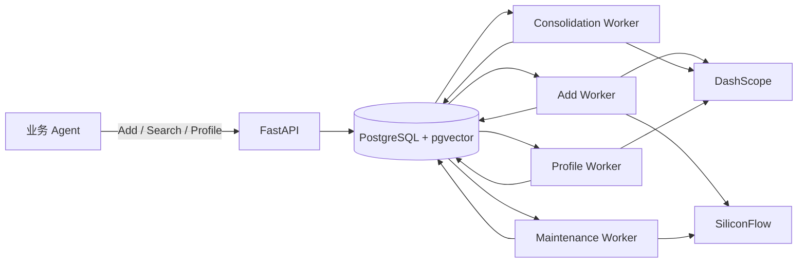

# 项目架构与数据流

## 一句话理解

业务 Agent 把对话消息提交给 API；API 持久化原始来源并入队；后台任务将来源抽取成带证据的记忆；Search 和 Profile 只读取当前有效、归属正确的结果。治理、向量维护、到期和审计围绕这条主链路运行。

## 工程结构

```text
MemoryCMIC/
├── src/memory_cmic/       API、领域逻辑、四种 Worker、ORM 模型
├── src/migration_tools/   Honcho 历史数据迁移工具
├── migrations/            Alembic 数据库迁移；版本顺序见 versions/
├── tests/                 按能力组织的自动化测试
├── docs/                  当前运行说明、设计方案与本交接文档
├── reports/               特定验证批次的结果与评估材料
├── scripts/               验证、评估、回填和场景迁移脚本
├── datas/                 测试/迁移样本与映射数据
├── pyproject.toml         Python 依赖、命令入口与检查配置
└── docker-compose.yml     本地 PostgreSQL + pgvector
```

运行依赖 Python 3.11+、PostgreSQL/pgvector、DashScope 模型服务和 SiliconFlow embedding 服务。`docker-compose.yml` 只启动数据库；API 和各 Worker 是独立进程。配置入口是 `.env.example` 与 `settings.py`。

## 运行组件

| 组件 | 入口 | 职责 |
| --- | --- | --- |
| API | `memory-cmic-api` → `server.py` → `api.create_app()` | Bearer 鉴权、请求校验、事务写入、查询和管理接口 |
| Add Worker | `memory-cmic-worker --role add` | 处理 `fact_extract`，抽取、判重、写事实和证据 |
| Maintenance Worker | `--role maintenance` | 向量 upsert/delete、TTL 到期、依赖复查 |
| Consolidation Worker | `--role consolidation` | 按用户整理重复、冲突和推断 |
| Profile Worker | `--role profile` | 重建用户画像及应用租户画像维度配置 |
| PostgreSQL | `models.py` + Alembic | 保存来源、记忆、证据、向量、任务、策略、审计 |



## 核心数据如何关联

| 对象 | 含义 | 关键关系 |
| --- | --- | --- |
| `source_record` | 原始消息或管理修改来源 | 原文、来源系统、用户、会话、Agent、时间和版本 |
| `conversation_session` | 同一来源会话的批次顺序 | 给 Add 任务分配 `batch_seq` |
| `memory_task`、`memory_task_source` | 持久化任务和任务输入来源 | 任务重试、租约、结果、来源与目标/历史角色 |
| `memory_item` | 事实或推断等记忆内容 | 主体、认知类型、业务/项目范围、状态、版本、生效与到期时间 |
| `memory_evidence` | 来源或记忆到下游对象的依据边 | `supports`、`derives`、`profile_basis` 及证据组 |
| `memory_embedding` | 当前模型下的检索向量 | 关联记忆、模型 ID、正文哈希和状态 |
| `profile_property`、`tenant_profile_config` | 用户画像陈述和租户维度配置 | 一个维度可有多条画像，每条有独立依据 |
| `governance_*` | 策略、用户待办、运行和操作记录 | 驱动后台整理、记录可撤销操作 |
| `memory_audit_log` | 只追加的业务变更事件 | `correlation_id` 串起接入、任务和治理操作 |

主要关系可以读成：`source_record` → `memory_evidence(supports)` → `memory_item(fact)` → `memory_evidence(derives/profile_basis)` → `memory_item(inference)` / `profile_property`。证据组内必须同时满足全部依据；多个独立完整组可以任选其一。读取时再次核验状态、时间、来源和版本，所以后台清理尚未完成时，也不能仅凭旧向量或旧画像返回失效内容。

## 四条典型链路

### 1. 新对话进入记忆

1. 调用 `POST /api/v1/memories:add`，提交目标消息、可选历史消息及 `Idempotency-Key`。
2. `ingest.py` 在同一事务里保存来源、任务、任务来源关联和审计。相同幂等键与相同请求返回原任务；同一消息 ID 绑定不同内容会冲突。
3. Add Worker 按会话批次顺序领取任务，冻结来源快照，按模型预算切片；模型抽取事实与依据，再做规则校验、场景规范化、候选判重与治理决策。
4. 分片提交事实、证据和新事实向量，任务最终为 `succeeded`、`partial` 或 `failed`。客户端可轮询 `GET /api/v1/tasks/{task_id}`；内部 `processing` 在此接口映射为 `pending`。

### 2. 任务检索和画像读取

Search 将任务文字向量化，召回同租户指定用户的有效候选，按来源/范围/时间/证据过滤；可选模型再判断任务适用性。Profile 读取已由 Profile Worker 蒸馏的陈述，不在读取请求中重建。两者都在返回前核验依据是否仍有效。

### 3. 修改、删除与到期

PUT 修改个人事实时创建一条有手工来源的新事实，旧事实失效；DELETE 将个人事实/推断标记为 `deleted`。到期由 maintenance 扫描并转成 `expired`。这些操作会传播依赖变化、使旧向量不可用并安排后台维护。删除是逻辑删除，原始来源和审计记录仍保存。

### 4. 后台治理

用户级状态积累变更后，手动或策略条件生成整理任务。Consolidation Worker 复核重复、争议、过时和推断；Profile Worker 在候选变化后按合并窗口重建画像。治理操作可通过对应管理接口查看，符合条件的操作可以撤销。

## 跨模块不变量

- 租户从服务凭证获得，不能由请求正文任意指定；用户 ID 当前由受信任接入后端提供。
- 原始来源、抽取记忆和画像是不同对象；来源或记忆版本变化必须重新检查下游依据。
- `NULL` 业务/项目范围表示不按该维度限制，非空数组表示指定范围；正文里的条件仍需保留和判断。
- `active` 只是必要条件；`effective_at`、`expired_at`、证据、向量版本也决定是否可读。
- API 成功入队不等于后台处理完成；四种 Worker 需要按实际能力分别运行。

设计背景见 [数据模型设计规范](统一记忆服务数据模型详细设计规范-V1.0-冻结版.md)。该规范是初版冻结设计；当前新增表、字段、状态和约束以 `models.py` 与 `migrations/versions/` 为准。
